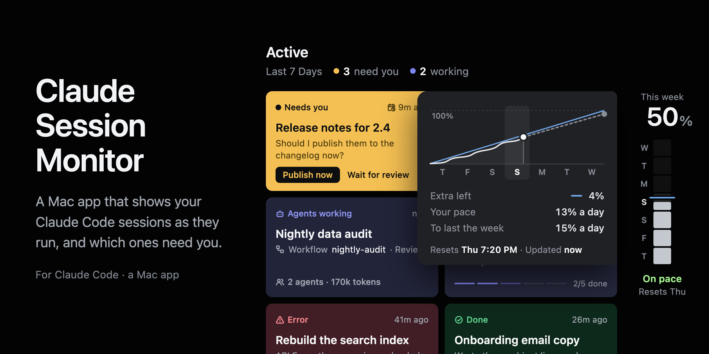
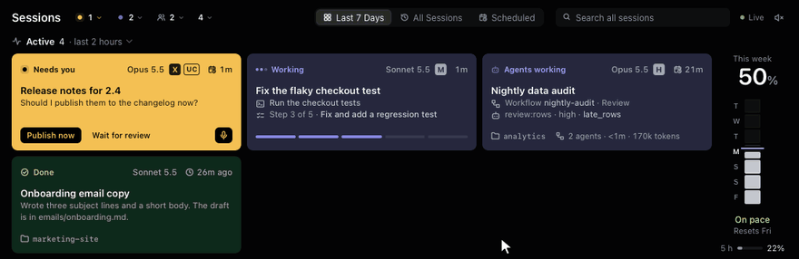

<p align="center">
  
</p>

<h1 align="center">Claude Session Monitor</h1>

<p align="center">
  A Mac app that shows your Claude Code sessions as they run:<br>
  what each one is doing, which ones need you, and what's scheduled next.
</p>

<p align="center">
  
  
  
  
</p>

<p align="center">
  
</p>

With a few Claude Code sessions going at once, the one that needs you is easy to miss. It sits in another window, waiting on a permission or a question, while you watch the one that's working. This app puts every session on one screen, colored by what it needs from you. It works with the Claude desktop app and with `claude` in a terminal, and your sessions never leave your Mac.

## Features

- **What needs you comes first:** a permission, a question, a turn that ended asking you something, an error, or a scheduled task that can't start. The same count shows on the Dock icon and in the menu bar.
- **It reads how a turn ended,** so "which one do you want?" counts as needing you and "anything else?" doesn't.
- **The work behind each session:** the tool it's using, the step of its plan, its subagents and workflows.
- **Scheduled tasks:** when each runs next, how the last run went, and runs that never happened.
- **Weekly usage:** how much of your plan's week you've used, whether you're on pace, and when you'd run out.
- **A real Mac app:** standard menus, Settings, keyboard navigation, VoiceOver labels and Reduce Motion.
- **It never slows Claude down:** the hook writes one line and exits.

Everything it shows is in the [guide](docs/guide.md).

## Install

Requires macOS 14 or later, Claude Code signed in with a Claude plan that includes it (Pro, Max, Team or Enterprise), [Bun](https://bun.sh) and `jq` (macOS 15 ships it; on 14, `brew install jq`).

1. If you don't have Claude Code yet, install it in Terminal, then run `claude` once and sign in with your Claude account in the browser. [The guide](docs/guide.md#install-in-detail) has Homebrew and the other ways.
   ```bash
   curl -fsSL https://claude.ai/install.sh | bash
   ```
2. Download the zip from the [latest release](https://github.com/creative-context/claude-session-monitor/releases/latest), unzip it and move the app to Applications.
3. Open it. The app isn't notarized, so the first time, open **System Settings › Privacy & Security** and click **Open Anyway**.
4. Click **Install Hook** when the app asks. It adds the hook to `~/.claude/settings.json`, after saving a copy.

Sessions show up as soon as they do something. The app tells you when a new version is out.

The weekly usage meter needs one more step: add the optional [usage plugin](docs/guide.md#the-usage-plugin), or [allow one folder once](docs/guide.md#weekly-usage). To build from source, see [Develop](#develop).

## Use

Open the app and leave it beside your work. **Last 7 Days** (⌘1) shows what's active as cards, most urgent first. **All Sessions** (⌘2) is every session, searchable. **Scheduled** (⌘3) lists your scheduled tasks. Click a card to open that session in the Claude app.

## Privacy

- Your sessions stay on your Mac. The server listens on `127.0.0.1` only.
- It keeps short excerpts (titles, the first 200 characters of a prompt, a last recap) in `~/.claude-session-monitor`, never whole conversations or what a scheduled task does.
- Its one network request is a daily check for a new version, to GitHub, which you can turn off. To read your weekly usage it may start Claude Code for a few seconds, every 10 minutes at most; the usage plugin makes that unnecessary.

Every file it reads, keeps or changes is listed in [docs/privacy.md](docs/privacy.md).

## Uninstall

Remove the hook in Settings, then:

```bash
rm -rf "/Applications/Claude Session Monitor.app" ~/.claude-session-monitor
```

## Develop

```bash
git clone https://github.com/creative-context/claude-session-monitor.git
cd claude-session-monitor
sh app/build.sh --install   # build, copy to ~/Applications and open
bun test && bun test/scenarios.ts
```

How it's built, the other tests and what we learned from other projects are in [docs/architecture.md](docs/architecture.md). An AI agent working on this repository reads [`AGENTS.md`](AGENTS.md).

> This is an independent project. It isn't made, endorsed or supported by Anthropic. Claude and Claude Code are trademarks of Anthropic.

## License

[MIT](LICENSE). `public/anime-layout.js` is anime.js 4.5.0 by Julian Garnier, also MIT; its license is at the top of that file.
