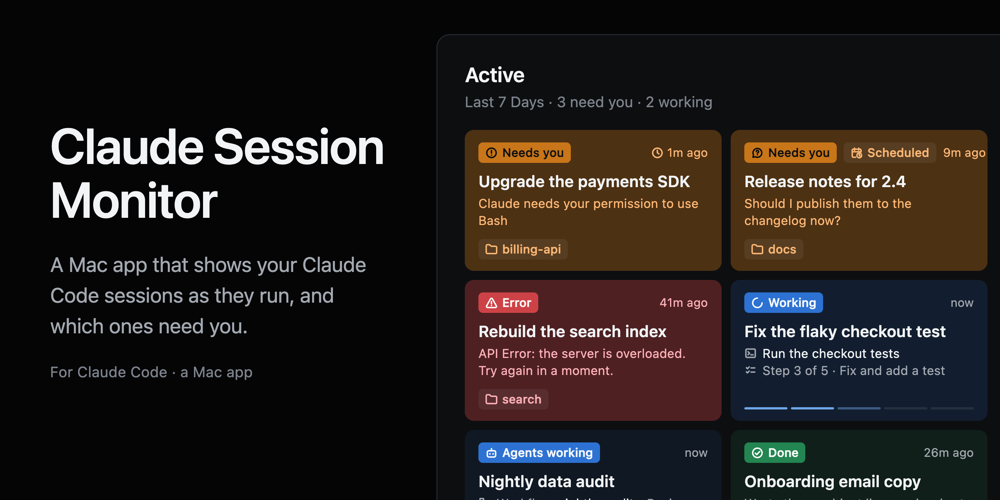
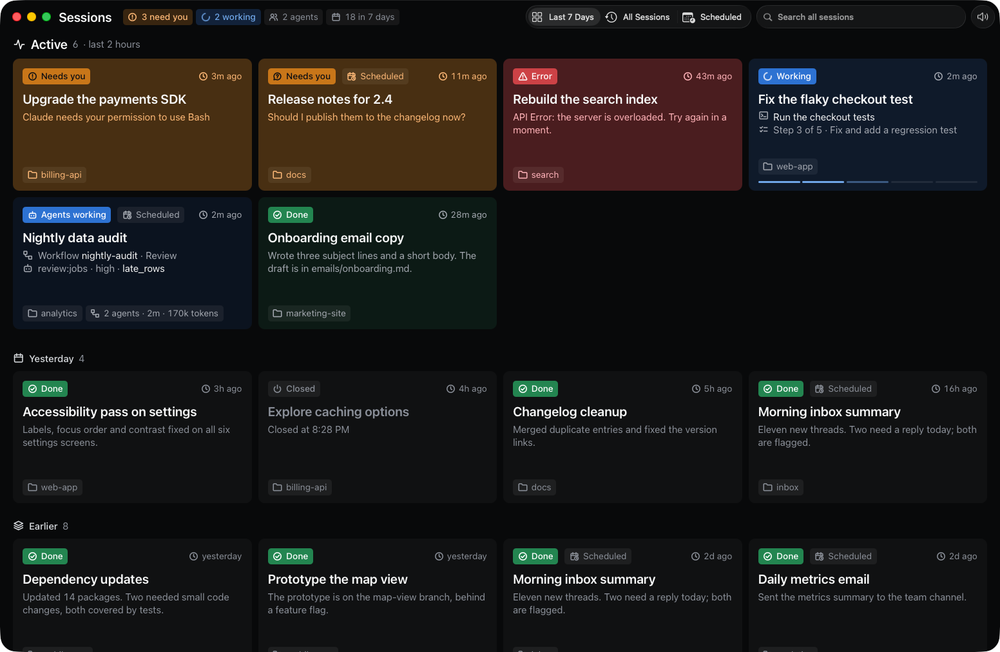

<p align="center">
  
</p>

<h1 align="center">Claude Session Monitor</h1>

<p align="center">
  A Mac app that shows your Claude Code sessions as they run:<br>
  what each one is doing, which ones need you, and what's scheduled next.
</p>

<p align="center">
  <b>Version 0.3</b> · For the Claude desktop app and the <code>claude</code> CLI · Built with Swift and <a href="https://bun.sh">Bun</a>
</p>

<p align="center">
  
  
  
  
</p>

<p align="center">
  <a href="https://github.com/creative-context/claude-session-monitor/releases/latest"><b>Download</b></a> ·
  <a href="#getting-started"><b>Getting started</b></a> ·
  <a href="#what-it-shows"><b>What it shows</b></a> ·
  <a href="#privacy"><b>Privacy</b></a> ·
  <a href="#ai-assistants"><b>AI assistants</b></a> ·
  <a href="CHANGELOG.md"><b>Changelog</b></a>
</p>

## Overview

With a few Claude Code sessions going at once, the one that needs you is easy to miss. It sits in another window, waiting on a permission or a question, while you watch the one that's working.

This app puts every session on one screen, colored by what it needs from you. It works with the Claude desktop app and with `claude` in a terminal, and your sessions never leave your Mac.

**What it does differently:**

- **What needs you comes first.** A session blocked on a permission or a question, one whose turn ended asking you something, and one that stopped on an error get the strongest colors and the top of the screen. The same count shows in the window, on the Dock icon and in the menu bar.
- **It reads how a turn ended.** A closing question, a request without a question mark ("let me know which one") and an API error each count as needing you. Courtesy closings don't.
- **It sees the work behind a session.** The tool it's using and on what, the step of its plan, and its subagents and workflows with their phase and tokens.
- **Scheduled tasks too.** When each task runs next, how its last run went, and which runs never happened.
- **A real Mac app.** A standard window with the usual menus, Settings, a right-click menu, keyboard navigation and VoiceOver labels. Calm motion, with Reduce Motion respected.
- **It never slows Claude down.** The hook writes one short line and exits, never with an error, so it can't block or break a session.



**Requirements:** macOS 14 or later on Apple silicon or Intel, Claude Code, [Bun](https://bun.sh) and `jq`. macOS 15 and later ship `jq`. On macOS 14, `brew install jq`.

**Status:** 0.x. It reads files Claude Code and the Claude app keep but don't document, so a future version of either can take some detail away.

> This is an independent project. It isn't made, endorsed or supported by Anthropic. Claude and Claude Code are trademarks of Anthropic.

## Getting started

### Download the app

1. Download `Claude-Session-Monitor-0.3.2.zip` from the [latest release](https://github.com/creative-context/claude-session-monitor/releases/latest), unzip it and move the app to Applications.
2. Open it. The app isn't notarized, so the first time macOS says it can't check it. Open **System Settings › Privacy & Security** and click **Open Anyway**. Or run:

   ```bash
   xattr -dr com.apple.quarantine "/Applications/Claude Session Monitor.app"
   ```
3. The app asks to connect Claude Code. **Install Hook** adds the hook to `~/.claude/settings.json`. It saves a copy of the file first and changes nothing else. You can install or remove it later in Settings (⌘,).

Sessions show up as soon as they do something. Open at Login is off until you turn it on in Settings.

The app tells you when a newer version is out, with a notification and a notice in the window, and **Check for Updates…** in its menu looks right away. To update, download the new version and put it in Applications in place of the old one.

### Build from source

```bash
git clone https://github.com/creative-context/claude-session-monitor.git
cd claude-session-monitor
sh app/build.sh --install
```

That builds the app with the Xcode command line tools (`xcode-select --install`), copies it to `~/Applications` and opens it. The app carries its own copy of the server, the page and the hook.

To use a browser instead of the app, run `bun install-hooks.ts` once, then `bun server.ts`, and open http://127.0.0.1:4747.

### Uninstall

Remove the hook in Settings (or run `bun install-hooks.ts --uninstall` from a clone), then:

```bash
rm -rf "/Applications/Claude Session Monitor.app" ~/.claude-session-monitor
```

### AI assistants

To have Claude Code set it up on your Mac, give it this line:

> Install Claude Session Monitor from https://github.com/creative-context/claude-session-monitor on this Mac. Follow the Getting started section of its README, and ask me before installing the hook.

To work on this repository itself, an agent reads [`AGENTS.md`](AGENTS.md), which `CLAUDE.md` imports.

## What it shows

- **Last 7 Days** (⌘1). **Active** comes as cards: what needs you, what's working, and anything touched in the last two hours, most urgent first. Under it, the rest of today, yesterday and earlier come as rows, and a long day splits into two columns in a wide window. After 7 days a session leaves this view on its own.
- **All Sessions** (⌘2). Every session ever, grouped by day and searchable by title, first prompt, project or last recap. The ones still going keep their color and update as they change. A long day splits into two columns in a wide window, as in Last 7 Days. On first run it fills in from the sessions the Claude app already has.
- **Scheduled** (⌘3). The tasks you scheduled in the Claude app: when each one runs, when it runs next, how its last run went and a dot for each of its last seven runs. A task that should have run and didn't says Missed. Its runs show up in the other views too, with a calendar clock by their time.

Hover a count in the header (needs you, working, agents, last 7 days) to see what's behind it, and click the count or one of its rows to jump to those cards. Click a card or a row of All Sessions to open that session in the Claude app, or a task's last run. Right-click to copy its title or show its project or task file in Finder. Arrow keys move between cards, and an optional sound tells you when something new needs you.

### States

Most urgent first. The whole card takes its state's color, strongest for what needs you and for errors.

| State | Color | When |
|---|---|---|
| Needs you | Orange, strong | Blocked mid-turn: it asks for permission, asks a question, waits for a plan approval or needs input. Or its turn ended asking you something: the app's next-step question, a question in the last two sentences of its closing message, or a request without a question mark. Questions count for a day |
| Error | Red, strong | An API error ended the turn, such as a server error or a usage limit. Caught with or without a `Stop` event. Errors count for a day |
| Working | Blue | Thinking or using a tool |
| Agents working | Light blue | Its own turn ended, but subagents or a workflow are still running |
| Done | Green in Active, plain after that | Finished its turn, or you stopped it |
| Idle | None | Open, with no turn yet |
| Closed | None | Its process is gone |

A card that starts needing you breathes for its first minute, then holds still. How a turn ended is read from the end of its transcript about a second after `Stop`. Errors are the lines Claude Code marks with `isApiErrorMessage`.

## Privacy

Your sessions stay on your Mac. The server listens on `127.0.0.1` only and answers only requests addressed to its own host name.

**What it keeps,** in `~/.claude-session-monitor`:

- `events.jsonl`: one line per Claude Code event. Each line has the session ID, its folder, the tool's name and a short detail (a file name, or a command or its description, up to 160 characters), the first 200 characters of each prompt, and the text of a session's last question or recap, up to 300 characters. The file rotates at 8 MB.
- `sessions.db`: one row per session with its title, folder, first prompt, status, last recap or question, its scheduled task if it's a run of one, and times.
- `hooks/`: the app's copy of the hook, when the app installed it.

It never stores whole conversations.

**What it reads and never writes:**

- The end of each session's transcript in `~/.claude/projects`, to tell how a turn ended and to find its subagents and workflows.
- The Claude desktop app's session files in `~/Library/Application Support/Claude`, for titles, the archived flag and which scheduled task a session is a run of.
- The app's `scheduled-tasks.json` in the same folder, for each task's name, schedule, folder and run times. It never reads what a task does.

**What it changes:** the hook entries in `~/.claude/settings.json`, and nothing else.

**What it sends:** once a day, and when you choose Check for Updates…, a request to GitHub's public API for the newest release of this app. It carries nothing about you or your sessions. GitHub sees your IP address, as with any web page. Turn the daily check off in Settings › Updates.

## How it works

1. **Hook** (`hooks/session-hook.sh`). Claude Code runs it on every event of every session, and it appends one short line to `events.jsonl`. No network, no output, and it always exits 0. It takes about 12 ms.
2. **Server** (`server.ts`, Bun). It reads that file, keeps a small state per session, saves it to `sessions.db` and streams it to the page. `cron.ts` reads the scheduled tasks' schedules, to say them in words and to work out the next run and a missed one.
3. **Page** (`public/index.html`). The cards, the three views and their empty and offline states. It uses the colors of the [Obsidian theme](https://github.com/creative-context/astryx-theme-obsidian) and Apple\'s system fonts, SF Pro and SF Mono, so it ships no font files.
4. **App** (`app/main.swift`). A standard macOS window with a transparent title bar, the usual menus, Settings, a toolbar for the views, search and sound, a Dock icon and a menu bar item. It runs the server it carries and starts it again if it stops.

## Develop

```bash
bun test/scenarios.ts    # end-to-end checks of the tricky cases, against a server with its own temp folder
bun test/demo.ts         # a server with made-up sessions and tasks on http://127.0.0.1:4748, for screenshots
bun test/demo.ts --edge  # the same, plus edge cases: long text, a usage limit, many agents
sh app/build.sh --release  # the universal app, zipped for a release
```

None of them reads your sessions or the Claude app's files. The app runs its own copy of the server, so rebuild it after changing `server.ts`, `cron.ts` or `public/`.

Every push to `main` runs the tests on GitHub Actions. Publishing a release builds the universal app on macOS and attaches the zip to it.

## Lessons from other projects

| Lesson | From |
|---|---|
| The hook hands off the event and exits right away, and never exits with an error | [agents-observe](https://github.com/simple10/agents-observe), and bug #30 in [claude-code-hooks-multi-agent-observability](https://github.com/disler/claude-code-hooks-multi-agent-observability) |
| The Claude process ID tells whether a session is alive. It's checked once to be Claude, in case the ID gets reused | [claude-glance](https://github.com/adrienlupo/claude-glance), [Vibe Notch](https://github.com/farouqaldori/claude-island) |
| Stopping a session sends no `Stop` event. It's caught from the interrupt marker in the transcript | Vibe Notch |
| A `PostToolUse` that arrives after `Stop` doesn't flip the session back to working | Vibe Notch #98 |
| Subagent events don't change the session's own status or trigger alerts | Vibe Notch #36 and #18 |
| Workflow agents never send `SubagentStart`, so agents are tracked by ID from their hooks and files, not with a counter | Found here |
| A run of a scheduled task is a normal session. Its file in the Claude app names its task (`scheduledTaskId`), and the task's schedule is a cron expression in local time | Found here |
| A comment line keeps a stream open, but the page can't see it. A ping event every 10 seconds lets the page notice a server that died without closing the connection | Found here |
| "Needs you" lasts until the next real activity | agents-observe |
| Only hook events that every Claude Code version in use knows are registered. Older versions lack `StopFailure` and `PermissionDenied` | agents-observe #7 |
| Memory stays flat: one small state per session, with a cap and a daily cleanup | Vibe Notch #112 |
| `claude://resume?session=…&cwd=…` opens a session in the app | [Raycast TokenTrack](https://github.com/raycast/extensions/tree/main/extensions/tokentrack), [agentsview](https://github.com/kenn-io/agentsview) |

## License

[MIT](LICENSE).
