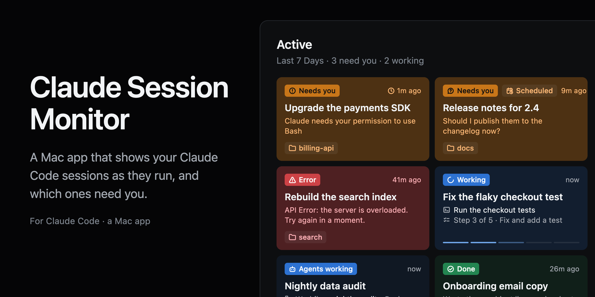
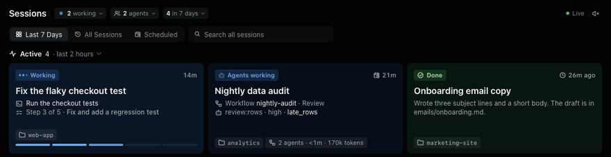

<p align="center">
  
</p>

<h1 align="center">Claude Session Monitor</h1>

<p align="center">
  A Mac app that shows your Claude Code sessions as they run:<br>
  what each one is doing, which ones need you, and what's scheduled next.
</p>

<p align="center">
  <b>Version 0.6</b> · For the Claude desktop app and the <code>claude</code> CLI · Built with Swift and <a href="https://bun.sh">Bun</a>
</p>

<p align="center">
  
  
  
  
</p>

<p align="center">
  <a href="https://github.com/creative-context/claude-session-monitor/releases/latest"><b>Download</b></a> ·
  <a href="#getting-started"><b>Getting started</b></a> ·
  <a href="#what-it-shows"><b>What it shows</b></a> ·
  <a href="#privacy"><b>Privacy</b></a> ·
  <a href="#ai-assistants"><b>AI assistants</b></a> ·
  <a href="CHANGELOG.md"><b>Changelog</b></a>
</p>

<p align="center">
  
</p>

## Overview

With a few Claude Code sessions going at once, the one that needs you is easy to miss. It sits in another window, waiting on a permission or a question, while you watch the one that's working.

This app puts every session on one screen, colored by what it needs from you. It works with the Claude desktop app and with `claude` in a terminal, and your sessions never leave your Mac.

**What it does differently:**

- **What needs you comes first.** A session blocked on a permission or a question, one whose turn ended asking you something, and one that stopped on an error get the strongest colors and the top of the screen, and so does a scheduled task the Claude app can't start. The same count shows in the window, on the Dock icon and in the menu bar, whose menu lists them with why each one needs you; pick one to open it.
- **It reads how a turn ended.** A closing question, a request without a question mark ("let me know which one"), an API error, and a turn the Claude app itself marks as needing you each count as needing you. Courtesy closings don't: "anything else?", or an open offer like "if you want another change, let me know".
- **It sees the work behind a session.** The tool it's using and on what, the step of its plan, and its subagents and workflows with their phase and tokens.
- **Scheduled tasks too.** When each task runs next, how its last run went, and which runs never happened. A session that set itself a reminder or set up a task says so on its card.
- **A real Mac app.** A standard window with the usual menus, Settings, a right-click menu, keyboard navigation and VoiceOver labels. Calm motion, with Reduce Motion respected.
- **It never slows Claude down.** The hook writes one short line and exits, never with an error, so it can't block or break a session.


**Requirements:** macOS 14 or later on Apple silicon or Intel, Claude Code, [Bun](https://bun.sh) and `jq`. macOS 15 and later ship `jq`. On macOS 14, `brew install jq`.

**Status:** 0.x. It reads files Claude Code and the Claude app keep but don't document, so a future version of either can take some detail away.

> This is an independent project. It isn't made, endorsed or supported by Anthropic. Claude and Claude Code are trademarks of Anthropic.

## Getting started

### Download the app

1. Download `Claude-Session-Monitor-0.6.7.zip` from the [latest release](https://github.com/creative-context/claude-session-monitor/releases/latest), unzip it and move the app to Applications.
2. Open it. The app isn't notarized, so the first time macOS says it can't check it. Open **System Settings › Privacy & Security** and click **Open Anyway**. Or run:

   ```bash
   xattr -dr com.apple.quarantine "/Applications/Claude Session Monitor.app"
   ```
3. The app asks to connect Claude Code. **Install Hook** adds the hook to `~/.claude/settings.json`, and a status line for your weekly usage if you have none. It saves a copy of the file first and changes nothing else. You can install or remove it later in Settings (⌘,).

Sessions show up as soon as they do something. Open at Login is off until you turn it on in Settings.

The app tells you when a newer version is out, with a notification and a notice in the window, and **Check for Updates…** in its menu looks right away. To update, download the new version and put it in Applications in place of the old one.

### The usage plugin (optional)

The weekly usage comes faster, and without the app ever opening Claude Code in a hidden terminal, with a small Claude Code plugin. Each time Claude Code measures your plan's limits, in a terminal or in the Claude app, it saves the two percentages for the app. It shows nothing, adds no command, and makes no request. In a terminal session:

```
/plugin install session-usage --marketplace creative-context/claude-session-monitor
```

Answer `y` to add the marketplace and choose the user scope, so every session loads it. In the Claude app, click + next to the prompt box, then **Plugins**, **Add marketplace** with `creative-context/claude-session-monitor`, then **Add plugin**. It's in `plugin/` in this repository.

A session loads plugins when it starts, so sessions already open don't have it yet: run `/reload-plugins` in each, or open new ones. Until then, the usage from those sessions comes from the app's own check, up to 10 minutes late.

### Build from source

```bash
git clone https://github.com/creative-context/claude-session-monitor.git
cd claude-session-monitor
sh app/build.sh --install
```

That builds the app with the Xcode command line tools (`xcode-select --install`), copies it to `~/Applications` and opens it. The app carries its own copy of the server, the page and the hook.

To use a browser instead of the app, run `bun install-hooks.ts` once, then `bun server.ts`, and open http://127.0.0.1:4747.

### Uninstall

Remove the hook in Settings (or run `bun install-hooks.ts --uninstall` from a clone), then:

```bash
rm -rf "/Applications/Claude Session Monitor.app" ~/.claude-session-monitor
```

### AI assistants

To have Claude Code set it up on your Mac, give it this line:

> Install Claude Session Monitor from https://github.com/creative-context/claude-session-monitor on this Mac. Follow the Getting started section of its README, and ask me before installing the hook.

To work on this repository itself, an agent reads [`AGENTS.md`](AGENTS.md), which `CLAUDE.md` imports.

## What it shows

- **Last 7 Days** (⌘1). **Active** comes as cards: what needs you, what's working, anything touched in the last two hours (pick 4, 8, 12 or 24 in its header) and anything set to pick up again on its own, most urgent first. Under it, the rest of today, yesterday and earlier come as rows, and a long day splits into two columns in a wide window. After 7 days a session leaves this view on its own.
- **All Sessions** (⌘2). Every session ever, grouped by day and searchable by title, first prompt, project or last recap. The ones still going keep their color and update as they change. A long day splits into two columns in a wide window, as in Last 7 Days. On first run it fills in from the sessions the Claude app already has.
- **Scheduled** (⌘3). The tasks you scheduled in the Claude app: when each one runs, when it runs next, how its last run went and a dot for each of its last seven runs. A task that should have run and didn't says Missed. One the Claude app tried to start and couldn't says Can't run, in red, with why, usually that its last run is still open. It shows in Active too and counts as needing you, and a click opens the run that holds it up. A one-time task moves to Ran once after it runs. Its runs show up in the other views too, with a calendar clock by their time.

A session that set itself a reminder, with `/loop`, a cron job or a wakeup, shows when it picks up again by an alarm clock, until its time comes or the session closes. One that set up a scheduled task shows the task's name; click it to see the task in Scheduled.

A side session, one the Claude app started from another session, says which one it came from on its card, and that session says how many side sessions it started. Point at either one and its family stays in focus while everything else steps back, wherever they are on screen, and click the tag to open it. In a full footer the name shortens; the whole name is in the tag's tip and in what VoiceOver reads. Only the Claude app records this, so sessions you start with `claude` in a terminal never show it.

**Weekly usage.** At the right of Active, a narrow column shows how much of your plan's weekly limit you've used: the figure, then the week as seven blocks from the reset, bottom up, filled up to what you've used, with a blue line for now, where an even week would be. Under it, how that compares: Plenty left, On pace, A little fast, Running hot, Almost at the limit or, at 100%, Limit reached, and the day it resets. Only the part ahead of the blue line takes a color, orange when you run hot, and the whole fill turns red at 90%. Ahead of pace, once a day of the week has gone by (sooner near the limit), the reset gives way to when you'd run out at the week's average pace, to the hour, if that comes before the reset: "Out Wed 1 PM". Pointing at the column, or reaching it with the keyboard, opens a card with that forecast in a solid block, the week as a curve against the blue diagonal of an even week (today has its band and a dot at now, and a dashed line goes on at the same pace to where it ends, with a dotted line down to the day it reaches 100% when that comes before the reset), the pace in the column's own words with how far over or under the blue line you are (or on the line), your pace a day once the first day has gone by, the most a day that lasts until the reset, the last 5 hours on plans that have that limit, and when it resets. The curve comes from the readings the app keeps through the week. In a narrow window and in the other views, a small version sits in the header instead. Claude Code only hands these numbers to a status line, and the Claude app doesn't run one, so the hook installer adds a small status line to `~/.claude/settings.json` (only when you have none), and, when the numbers are more than a few minutes old and you've used Claude Code since, at most every 10 minutes the app opens Claude Code in a hidden terminal for a few seconds, in its own empty folder and without your settings, so it runs that status line. Nothing is sent to Claude and no session is saved. Allow that folder once, from a terminal:

```bash
mkdir -p ~/.claude-session-monitor/probe && cd ~/.claude-session-monitor/probe && claude --setting-sources project --strict-mcp-config
```

Choose **Yes, I trust this folder**, then quit with Ctrl-C. Until then, the meter updates only when you use `claude` in a terminal. With the [usage plugin](#the-usage-plugin-optional), none of this is needed: every session hands the app its numbers, and the hidden check doesn't run while they're fresh.

**Compact view.** In a window narrower than 640 points, as on a laptop screen on its own, Active turns into rows: a dot in the state's color, the title and time, the question or what the session is doing, its folder and relations on one line, and the plan's bar, on the same tinted backgrounds as the cards. The weekly usage becomes one line above it, and the view switch keeps only its icons. Under 300 points it becomes a strip for the side of the screen: how many sessions need you, the week in two lines, and each session's dot, title, time and question. The window goes down to 171 points wide at 100% zoom, and proportionally more when the page is zoomed in.

Hover a count in the header (needs you, working, agents, last 7 days) to see what's behind it, and click the count or one of its rows to jump to those cards. Click a card or a row of All Sessions to open that session in the Claude app, or a task's last run. Right-click to copy its title or show its project or task file in Finder. Arrow keys move between cards, and an optional sound tells you when something new needs you.

### States

Most urgent first. The whole card takes its state's color, strongest for what needs you and for errors.

| State | Color | When |
|---|---|---|
| Needs you | Orange, strong | Blocked mid-turn: it asks for permission, asks a question, waits for a plan approval or needs input. Or its turn ended asking you something: the app's next-step question, a question in the last two sentences of its closing message or at the end of a point in the list it ends on, a request without a question mark, or the Claude app's own summary of the turn saying you need to do something. Questions count for a day |
| Error | Red, strong | An API error ended the turn, such as a server error or a usage limit. Caught with or without a `Stop` event. Errors count for a day |
| Working | Blue | Thinking or using a tool |
| Agents working | Light blue | Its own turn ended, but subagents or a workflow are still running |
| In the background | Light blue | Its own turn ended, but a shell command it started is still running; Claude Code wakes the session when it ends. The card shows the command's description. It counts until Claude Code says the command ended or it's stopped, for two hours at most |
| Done | Green in Active, plain after that | Finished its turn, or you stopped it |
| Idle | None | Open, with no turn yet |
| Closed | None | Its process is gone |

A card that starts needing you breathes for its first minute, then holds still. How a turn ended is read from the end of its transcript about a second after `Stop`. Errors are the lines Claude Code marks with `isApiErrorMessage`.

## Privacy

Your sessions stay on your Mac. The server listens on `127.0.0.1` only and answers only requests addressed to its own host name.

**What it keeps,** in `~/.claude-session-monitor`:

- `events.jsonl`: one line per Claude Code event, written by the hook. Each line has the time, the event's name, the session ID, its folder, the path of its transcript, the ID of the Claude Code process, the permission mode, and a subagent's ID when the event is one of its own. For a tool, its name and a short detail, up to 160 characters: a description, a file name or path, a command, a search pattern, a URL, a web search query, a skill's name or a title. It also has the first 200 characters of each prompt; a notification's type and its first 200 characters; how a session started and why it ended; the steps of a session's plan, at most 20 of 90 characters each, with their status; the first question a session asks you, up to 160 characters; and its last recap, up to 300 characters, and question, up to 140. For a reminder a session sets itself, it has when it fires, how often and its ID, never what it will do. For a scheduled task a session sets up, it has the task's title and ID, never its description or instructions. Past 8 MB the server moves it to `events.1.jsonl`, replacing the one before, while it runs and when it starts. `events.pos.json` holds where the server stopped reading it: a byte offset, the file's inode number and the 64 bytes before the offset.
- `sessions.db`: one row per session with its title, latest prompt, folder and the app's folder for it, transcript path, model, process ID, status, how its last turn ended, its last recap or question, an API error's first 160 characters, a short note this app writes ("You stopped it", "Closed in the middle of a turn"), the archived flag, its scheduled task if it's a run of one, its pending reminders and the tasks it set up, what it waits on while it waits on you (the same words the window shows, and which agent asked), and when it started and was last active.
- `server.log`: what the server prints (when it started, how many sessions it found, a usage check that was skipped, and any error with its stack, which can name files), and the app's own lines, marked `app:`: the path and version of Bun, the server's process ID and version, why a server was restarted, and a blocked attempt to leave the local page. Past 8 MB at a server start, the server moves the old part to `server.1.log`.
- `usage.json`: your plan's weekly and 5-hour usage, as two percentages and when each resets, written by the status line. Nothing else from what Claude Code gives a status line is kept.
- `usage-history.jsonl`: the week's share used each time it changes, with the time and when the week resets, for the week's curve. Only those three numbers per line, and a little more than a week of them.
- `probe/` and `probe.exp`: the empty folder and the script for the 10-minute usage check.
- `hooks/`: the app's copy of the hook and the status line, when the app installed them.

It never stores whole conversations.

**What it reads and never writes:**

- The names of the transcript files in `~/.claude/projects`, to find a session's transcript.
- The end of each session's transcript, the last 256 KB: how its latest turn ended (the closing message, an interruption, an API error), and whether a shell command it moved to the background is still running: the command's ID, when it started and its short description, never the command itself. When the server first meets a session, the last 2 MB, for its plan's steps and its last recap or question. For a workflow, the last 4 MB, for the run's name: the name given in the call, the file name of its script, or the name and description written in a script passed inline. It never opens the script file.
- Next to each transcript, its subagents' and workflows' files: each agent's description, phase, model and whether it runs in the background, from its `.meta.json`; the end of its transcript, for its context size, its last tool with a detail of up to 160 characters, and whether it finished; a run's journal, for which agents finished; and whether the run's result file exists, without reading it.
- The name of each session's process, once, to check it's Claude Code.
- When the app starts and another program already answers on its port: that program's process ID, its arguments and its folder, only to check it's this app's own server from an older version before stopping it. Nothing of it is kept, beyond the process ID and version in `server.log`.
- The Claude desktop app's session files in `~/Library/Application Support/Claude`. Each is read whole, again only when it changes, and only these fields are kept: the Claude Code session ID and the app's own, its title, the archived flag, model, folder, when it was created and last active, which scheduled task it's a run of, which session a side session was started from, and the app's summary of the latest turn: which message it sums up, whether the turn is complete, and its one-line note of what the turn needs from you, up to 200 characters.
- The app's `scheduled-tasks.json` in the same folder, for each task's ID, name, schedule, whether it's on, folder, the path of its file (for Reveal in Finder, never opened), when it was created and last ran, and when the app skipped a run and why, up to 40 characters. It never reads what a task does.

**What it changes:** the hook entries in `~/.claude/settings.json`, and its `statusLine` when you had none, and nothing else.

**What it sends:** once a day, and when you choose Check for Updates…, a request to GitHub's public API for the newest release of this app. It carries nothing about you or your sessions. GitHub sees your IP address, as with any web page. Turn the daily check off in Settings › Updates.

**The usage plugin**, when you install it, writes only `usage.json`: the same two percentages and resets as the status line, when Claude Code measures them, and only if the app's folder exists. It reads nothing else and sends nothing.

**What it starts:** every 10 minutes at most, while the hook is active, you have used Claude Code since the last check and the numbers are more than a few minutes old, Claude Code itself, for a few seconds, to read your usage (see What it shows). Claude Code connects to Anthropic as it always does when it starts, with your own sign-in, and keeps its own record of the folder as it does for any folder you open; the app adds nothing to that and sends nothing of its own. If the folder isn't allowed yet, it tries again six hours later.

## How it works

1. **Hook** (`hooks/session-hook.sh`). Claude Code runs it on every event of every session, and it appends one short line to `events.jsonl`. No network, no output, and it always exits 0. Its neighbor `hooks/statusline.sh` is the status line that saves your usage.
2. **Server** (`server.ts` and `src/`, Bun). It reads that file, keeps a small state per session, saves it to `sessions.db` and streams it to the page, only when something changed. After a restart it goes on reading the log where it stopped. It makes the one list of what needs you that the window, the Dock and the menu bar show. `closing.ts` holds the rules that tell a closing message that asks you from one that only reports, and `cron.ts` reads the scheduled tasks' schedules, to say them in words and to work out the next run and a missed one. Inside the app it ships as one bundled `server.js`.
3. **Page** (`public/index.html`). The cards, the three views and their empty and offline states. It uses the colors of the [Obsidian theme](https://github.com/creative-context/astryx-theme-obsidian) and Apple\'s system fonts, SF Pro and SF Mono, so it ships no font files. In Last 7 Days, cards that move, leave or turn into rows are animated with the layout module of [anime.js](https://animejs.com), which ships inside the app (`public/anime-layout.js`), so it loads nothing from the network. Reduce Motion turns it off.

   Its tokens, shared components and icons come from the family's design system, [mac-app-design](https://github.com/creative-context/mac-app-design), vendored next to the page (`public/design-*`), so the family's apps look the same.
4. **App** (`app/main.swift`). A standard macOS window with a transparent title bar, the usual menus, Settings, a toolbar for the views, search and sound, a Dock icon and a menu bar item. In full screen the toolbar hides with the menu bar, as in Safari, so the page fills the screen; it comes down when the pointer reaches the top. It runs the server it carries, starts it again if it stops, and replaces one an older version left running. It takes its counts for the Dock and the menu bar from the page.

## Develop

```bash
bun test                 # unit tests: the closing rules, the usage words, the log, the readers, the server's state
bun test/scenarios.ts    # end-to-end checks of the tricky cases, against a server with its own temp folder
bun test/lifecycle.ts    # starts, stops, restarts, a taken port, the app going away, the log rotating
bun test/demo.ts         # a server with made-up sessions and tasks on http://127.0.0.1:4748, for screenshots
bun test/demo.ts --edge  # the same, plus edge cases: long text, a usage limit, many agents
bun test/demo.ts --hot   # the same, with a week running hot (--limit: a week used up)
sh app/build.sh --release  # the universal app, zipped for a release
```

The README's pictures are drawn by scripts, in a window that never shows on screen and with the page's clock in UTC: `docs/screenshot.swift` (the command is at its top) and `docs/demo-gif.swift`, which starts its own demo.

None of them reads your sessions or the Claude app's files. The app runs its own copy of the server, so rebuild it after changing `server.ts`, `src/`, `closing.ts`, `cron.ts` or `public/`.

Every push to `main` runs the tests on GitHub Actions. Publishing a release builds the universal app on macOS and attaches the zip to it.

## Lessons from other projects

| Lesson | From |
|---|---|
| The hook hands off the event and exits right away, and never exits with an error | [agents-observe](https://github.com/simple10/agents-observe), and bug #30 in [claude-code-hooks-multi-agent-observability](https://github.com/disler/claude-code-hooks-multi-agent-observability) |
| The Claude process ID tells whether a session is alive. It's checked once to be Claude, in case the ID gets reused | [claude-glance](https://github.com/adrienlupo/claude-glance), [Vibe Notch](https://github.com/farouqaldori/claude-island) |
| Stopping a session sends no `Stop` event. It's caught from the interrupt marker in the transcript | Vibe Notch |
| A `PostToolUse` that arrives after `Stop` doesn't flip the session back to working | Vibe Notch #98 |
| Subagent events don't change the session's own status or trigger alerts | Vibe Notch #36 and #18 |
| Workflow agents never send `SubagentStart`, so agents are tracked by ID from their hooks and files, not with a counter | Found here |
| A run of a scheduled task is a normal session. Its file in the Claude app names its task (`scheduledTaskId`), and the task's schedule is a cron expression in local time | Found here |
| A side session's file in the Claude app names the session it was started from (`spawnedFrom.sessionId`), by the app's own ID, not Claude Code's | Found here |
| A comment line keeps a stream open, but the page can't see it. A ping event every 10 seconds lets the page notice a server that died without closing the connection | Found here |
| "Needs you" lasts until the next real activity | agents-observe |
| Only hook events that every Claude Code version in use knows are registered. Older versions lack `StopFailure` and `PermissionDenied` | agents-observe #7 |
| Memory stays flat: one small state per session, with a cap and a daily cleanup | Vibe Notch #112 |
| `claude://resume?session=…&cwd=…` opens a session in the app | [Raycast TokenTrack](https://github.com/raycast/extensions/tree/main/extensions/tokentrack), [agentsview](https://github.com/kenn-io/agentsview) |

## License

[MIT](LICENSE). `public/anime-layout.js` is anime.js 4.5.0 by Julian Garnier, also MIT; its license is at the top of that file.
